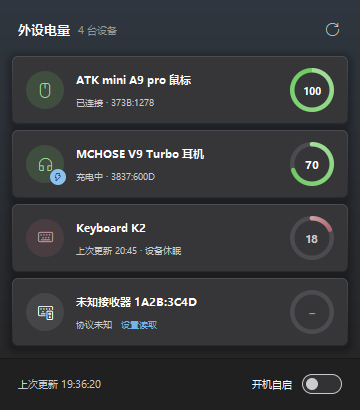

# 2.4G 外设电量

Windows 10/11 的无线外设电量托盘工具：2.4G 接收器 + 蓝牙设备。

> 本项目基于 [Ap0LoG1zE](https://github.com/Ap0LoG1zE) 的 [EZ2.4G](https://github.com/Ap0LoG1zE/EZ2.4G) 修改而来，核心思路与大部分底层代码出自原作者，详见文末[致谢](#致谢)。

纯 Python 标准库（`ctypes` + `tkinter`），**零第三方依赖**，不写日志。

> **甚至只需要网页版驱动就可以拿到电量协议**——不少 2.4G 外设的网页版驱动直接用 WebHID 查询电量，翻一眼协议比装 USBPcap 抓包省事得多。



## 下载

两种方式任选：

- **免安装（推荐）**：到 [Releases](../../releases/latest) 下载 `2.4G.exe`，双击运行，无需 Python。
  每次提交自动构建的测试版在 [Actions](../../actions/workflows/build.yml) 的 Artifacts 里（需登录 GitHub）；原作者发布的原版在[这里](https://github.com/Ap0LoG1zE/EZ2.4G/releases)。
- **最小体积**：下载 `my_devices.py`（约 185 KB），安装 Python 3.10+ 后运行：

```bat
python my_devices.py
```

> exe 未签名，Windows 可能提示 SmartScreen，选择“更多信息 → 仍要运行”。

## 功能

- Windows 11 Fluent 风格界面：跟随系统深浅色和强调色，Win11 原生圆角与阴影
- 同时显示**蓝牙设备**电量（耳机、鼠标、手写笔等，和 Windows 设置里看到的一致）：已连接的自动出现，右键可改名或“不再显示”，托盘右键菜单可整体关闭
- 托盘只放**一个图标**，显示所有设备里**最低的电量**；鼠标悬停列出每台设备的电量。**左键**弹出电量面板（贴着任务栏浮出，点别处自动收起），**右键**菜单可刷新、开关开机自启、退出
- 面板顶部显示 **CPU / GPU 温度**，打开面板时每 3 秒刷新，圆点颜色随温度变化（<70°C 绿、<85°C 黄、更高红），详见下方[温度说明](#cpu--gpu-温度)
- 面板里每台设备一张卡片：设备图标、状态、电量圆环；右键卡片可重命名、设置读取、删除
- 启动不自动添加 2.4G 设备；没有设备时显示「插入或重新拔插 2.4G 接收器即可添加」
- 新设备插入或重新拔插时弹窗确认，显示设备名、VID:PID 和当前电量
- 双击卡片上的设备名即可重命名，名称保存在配置里
- 右键设备卡片可删除该设备，同时清除它的抓包协议和上次电量
- 发现新设备时弹出 Fluent 风格确认对话框
- 自动刷新、开机自启（启动项名 `2.4G`）
- 只读查询，不修改设备设置

## 协议规则

软件**不内置设备协议表**，也不会按 VID:PID 自动匹配内置设备。

只有两种来源算“有协议”：

1. **标准 HID 电量能直接读到**：自动保存为 `{"kind": "standard"}`；
2. **抓包成功**：保存 `{"kind": "captured", "requests": [...], "offset": N}`。

设备休眠或未开机时：

- 有协议、也有上次电量：显示上次电量，副标题「上次更新 HH:MM · 设备休眠」；
- 有协议、但没有上次电量：显示「设备休眠」；
- 没有协议：显示「协议未知，无法读取电量」，不会假装休眠。

## CPU / GPU 温度

- **GPU**：读的是 Windows 任务管理器同款数据，NVIDIA / AMD / Intel 独显都支持，不需要管理员权限。需要 Windows 10 2004 及以上和较新的显卡驱动；核显通常不提供温度。
- **CPU**：Windows 不给普通程序读 CPU 真实温度的接口，所以分两种情况：
  - 运行着 [LibreHardwareMonitor](https://github.com/LibreHardwareMonitor/LibreHardwareMonitor)（需以管理员身份运行）时，读它的传感器，显示准确的封装 / 核心温度；
  - 否则退回系统的“热区”温度，数字前带 **≈** 表示近似。笔记本上大多可用；很多台式机读不到（显示 —）或是固定值。


- Windows 10/11 x64
- Python 3.10+（需包含 tkinter）
- 抓包需要 [USBPcap](https://desowin.org/usbpcap/) 和管理员权限

## 运行

```bat
python my_devices.py            :: 托盘常驻
python my_devices.py --once     :: 读一次并打印
python my_devices.py --list     :: 列出 HID 接口
python my_devices.py --panel    :: 只开面板，不常驻托盘
python my_devices.py --install  :: 创建开机自启 + 桌面入口
```

配置文件：`%APPDATA%\BatteryTray\config.json`

里面保存：

- `devices`：已添加的设备（VID、PID、名称）
- `protocols`：标准 HID 或抓包保存的协议
- `last`：每台设备上次成功读到的电量
- `interval`：刷新间隔
- `usbpcap`：USBPcapCMD 路径

## 未知设备抓包

1. 安装 USBPcap，重启电脑
2. 插拔一次要抓包的设备，在弹窗里点「添加」
3. **关闭厂家驱动**，点「开始抓包」并允许管理员权限
4. 打开厂家驱动，让它显示一次电量，记下数值
5. 点「停止」，填入刚才的电量
6. 只有一个字节符合：保存请求帧和电量字节位置
7. 多个字节符合：换一个不同电量再抓一次，对比两次字节差值
8. 保存后立即回读验证：
   - 主动回读失败时，会尝试被动监听输入报告；
   - 仍然失败会删除刚保存的协议，并提示「抓包中不含电量数据，可能是没按要求让厂商软件发电量请求」

提示：

- 没有匹配：注意抓包期间厂家驱动必须显示过电量；
- 匹配不准确：换一个相差 10% 以上的电量再抓；
- 多次没有结果：可能是厂家协议加密，无法通过抓包获取。

抓包分析会排除描述符、EP0 标准控制 setup、字符串描述符和全零报告；HID Feature Report 和厂商自定义报告会保留。

抓包保存的协议会记住请求和回复的形态，回读时按同样方式回放：

- 请求可以是中断 OUT、`SET_REPORT(Output)` 或 `SET_REPORT(Feature)`，回复可以是输入报告或 `GET_REPORT(Feature)`；
- 回复要和抓包时的报告特征（电量字节之前的前两个字节）一致才采信，不会把别的报告里的数字当成电量；
- 设备不使用报告 ID 时，自动按 Windows 缓冲区补齐首字节，偏移也随之修正。

旧版本保存的协议仍按原方式读取；如果读数不准，删除设备后重新抓一次即可升级为新格式。

## 限制

- 电量由设备上报，可能是 5% 步进
- 加密或私有握手协议无法通过抓包读取
- 仅支持 Windows 10/11 x64

## 文件

- `my_devices.py`：主程序（抓包助手已内置）
- `app.ico`：图标
- `启动.bat`：启动脚本（自动寻找 `pythonw` / `pyw`）
- `docs/panel.png`：界面截图
- `ci/`：协议、蓝牙、托盘、温度、界面测试，在 GitHub Actions 的 Windows 机器上运行
- `.github/workflows/build.yml`：测试并用 PyInstaller 打包 `2.4G.exe`

## 致谢

衷心感谢 **[Ap0LoG1zE](https://github.com/Ap0LoG1zE)** 和原项目 **[EZ2.4G](https://github.com/Ap0LoG1zE/EZ2.4G)**。

这个工具最难的部分都是原作者解决的：

- 只用 `ctypes` 直接调用 Windows 的 SetupAPI / HID 接口，做到**零第三方依赖**、一个文件就能跑；
- 「**抓包学习协议**」的思路：用 USBPcap 抓下厂商驱动查询电量的过程，用已知电量去匹配字节，一次不够就换个电量再抓、比较两次的差值——不用逆向厂商协议，普通用户也能让自己的设备显示电量；
- 「看一眼网页版驱动的 WebHID 请求就能拿到协议」这个实用的经验；
- 托盘里每台设备一个电量圆环，以及以管理员权限运行抓包助手、读不到电量时沿用上次读数等细节。

本仓库在此基础上做的改动：

- Windows 11 Fluent 风格的界面与动效，托盘左键弹出面板、右键菜单；
- 显示蓝牙设备电量；
- 抓包协议记录请求/回复形态，支持 Feature 报告和不带报告 ID 的设备，回复按特征过滤；
- 修复若干问题（标准 HID 电量读取、充满通知正文、`--once`、启动脚本路径等），清理不再使用的旧代码；
- 加入测试与自动打包。

原项目没有声明开源许可证，原有代码的版权归原作者所有。如果原作者对本仓库的公开方式有任何意见，请通过 Issue 联系，我会第一时间配合调整或下架。
